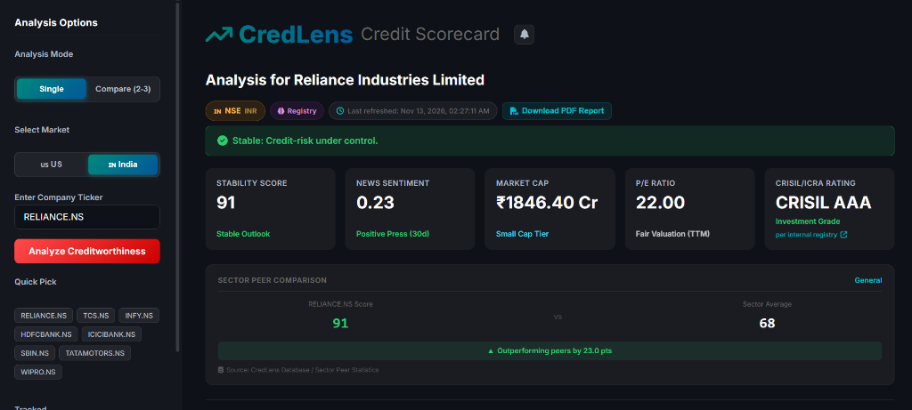
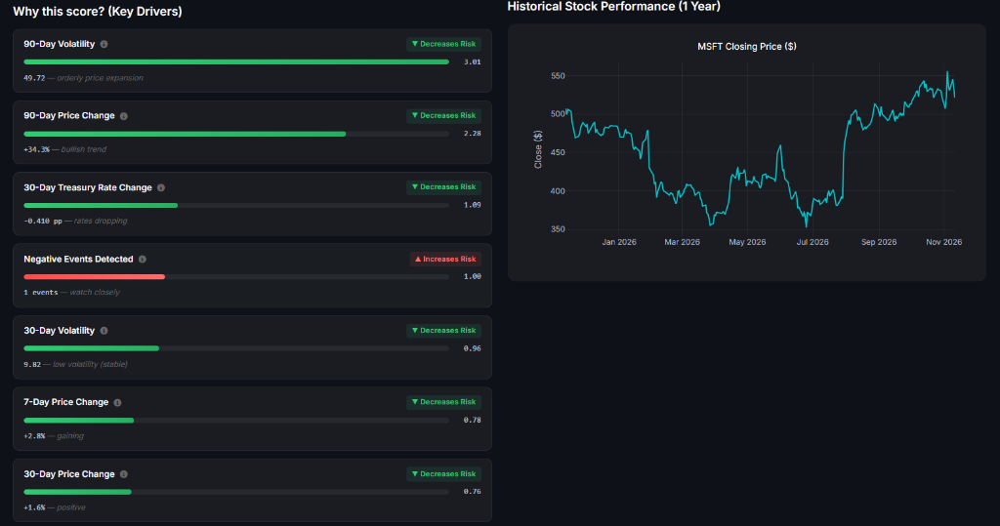
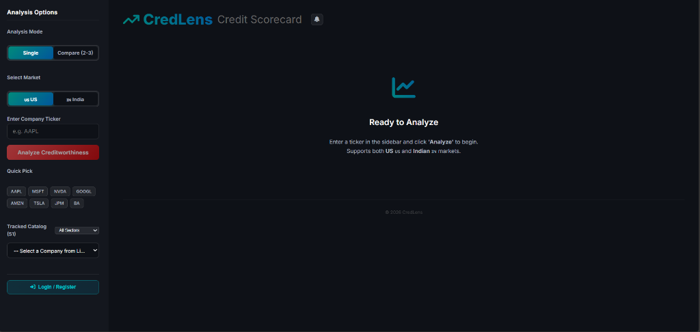
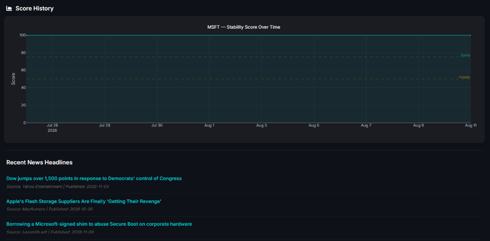
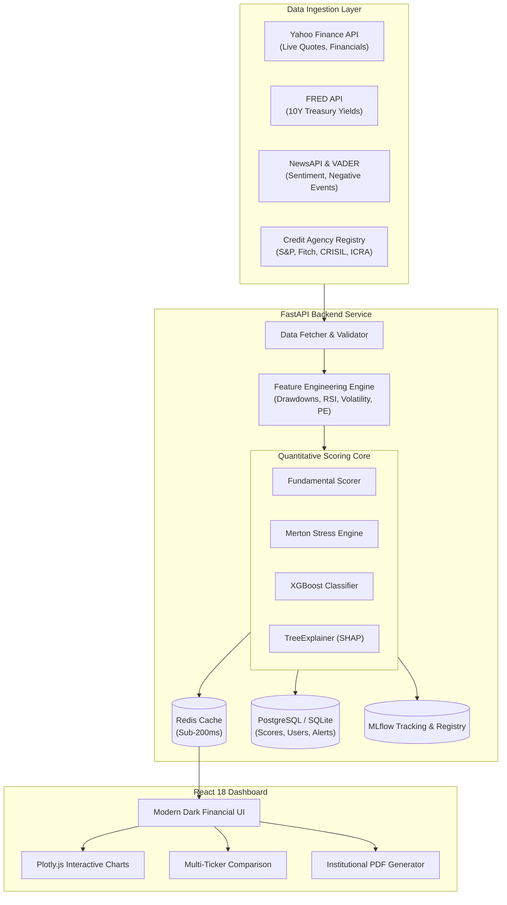

<div align="center">


# CredLens
### Institutional Multi-Market Credit Risk & Solvency Intelligence Platform

[](https://www.python.org/)
[](https://fastapi.tiangolo.com/)
[](https://react.dev/)
[](https://vitejs.dev/)
[](https://xgboost.readthedocs.io/)
[](https://mlflow.org/)
[](https://www.postgresql.org/)
[](https://redis.io/)
[](https://www.docker.com/)
[](LICENSE)
[](tests/)
[](https://multi-market-credit-risk.vercel.app)
[](https://credlens-api.onrender.com)

*An institutional-grade credit risk scoring and solvency surveillance platform evaluating public equities across **US (NYSE / NASDAQ)** and **Indian (NSE / BSE)** markets in real time.*

###  Live Deployments
- 🌐 **Web Application (Vercel):** [https://multi-market-credit-risk.vercel.app](https://multi-market-credit-risk.vercel.app)

[Key Capabilities](#key-capabilities) • [Scoring Methodology](#hybrid-scoring-methodology) • [System Architecture](#system-architecture) • [Quickstart](#quickstart--installation) • [API Reference](#api-endpoints) • [Tech Stack](#tech-stack-breakdown)

</div>

---

## Executive Summary

Traditional credit rating agencies (S&P, Moody's, Fitch, CRISIL, ICRA) publish static ratings that often lag abrupt market downturns, liquidity crunches, and rapid macroeconomic shifts by months. 

**CredLens** bridges this gap. It combines **balance-sheet solvency fundamentals** with **structural credit models (Merton / KMV distance-to-default framework)**, **XGBoost machine learning**, **macroeconomic yield curves (FRED)**, and **real-time NLP news sentiment** to deliver an adaptive, continuous **CredLens Stability Score (0–100)** with fully transparent **SHAP explainability**.

<div align="center">
  
  <p><em>Live Credit Scorecard, Sector Peer Benchmarking, Calibrated Stability Score (91 / CRISIL AAA)</em></p>
</div>

---

## Key Capabilities

- **Multi-Market Dual-Exchange Engine:**
  - Full native support for **US Equities** (NYSE, NASDAQ) in `USD ($)` and **Indian Equities** (NSE `.NS`, BSE `.BO`) in `INR (₹)`.
  - Country-specific macroeconomic baselines (S&P 500 vs. NIFTY 50 benchmarks; US 10-Year Treasury Yields vs. localized sovereign risk).

- **Hybrid Quantitative Credit Engine:**
  - **Fundamentals-First Anchor (0–100):** Evaluates leverage ratios (Debt-to-Equity), cash runway (Cash per Share), operational profitability (P/E), and banking soundness (ROE/ROA).
  - **Merton Structural Market Stress Adjustment:** Detects sharp equity market cap drawdowns (-10% to -25%), technical breakdown below moving averages, and oversold capitulation (RSI < 30) to compute continuous distance-to-default penalties.
  - **Machine Learning Classification:** Optuna-tuned XGBoost risk model predicting downside volatility and drawdown probability.

- **Explainable AI (XAI) with SHAP:**
  - Transparent feature attribution decomposes every stability score into exact quantitative drivers.
  - Strict economic sign-alignment guarantees that drawdowns, moving average breakdowns, and leverage spikes display as **`▲ Increases Risk` (red)**, while rate-cuts and cash buffers display as **`▼ Decreases Risk` (green)**.

- **Multi-Entity Comparison Mode:**
  - Compare 2 to 3 corporations side-by-side in real-time across stability scores, agency ratings, valuation multiples, and price trends.

- **Institutional PDF Report Generation:**
  - One-click export producing professional credit memos formatted for audit committees, risk officers, and investment desks.

- **MLOps & Continuous Tracking:**
  - Built-in MLflow registry tracking model versions, hyperparameters, and experiment runs, with automated model promotion and joblib fallbacks.

- **Surveillance & Proactive Alert Engine:**
  - Configurable alerts notifying users of score drops, transitions into volatile territory, negative news spikes, or credit recovery events.

---

## Platform Interface

| Live Analysis Scorecard & Benchmarking | Calibrated Key Drivers & 1-Year Performance |
|:---:|:---:|
|  |  |
| *Real-time credit scorecard, CRISIL/S&P rating & peer comparison* | *Economic SHAP attribution drivers with 1-year historical price chart* |

| Dual-Market Landing & Catalog | Score History & NLP News Surveillance |
|:---:|:---:|
|  |  |
| *US & Indian market switcher with quick-picks & catalog selection* | *Historical stability score trajectory with live negative-event news feed* |

---

## Hybrid Scoring Methodology

CredLens implements a **Fundamentals-First + Merton Structural ML** architecture:

```
+-------------------------------------------------------------+
|                 1. Solvency Foundation                      |
|   Rule-based fundamental score anchored to balance sheet    |
|   (Debt-to-Equity, Cash/Share, P/E Ratio, ROE/ROA)          |
|   Score Range: 0 to 100                                     |
+------------------------------+------------------------------+
                               |
                               v
+-------------------------------------------------------------+
|             2. Structural Market Stress & ML                |
|   - Merton Distance-to-Default Equity Drawdown Penalty      |
|   - XGBoost Probability Classifier (Optuna Tuned)           |
|   - Moving Average Breakdown & RSI Capitulation Check       |
|   - News NLP Sentiment & Negative Event Signals             |
|   Penalty Range: 0 to 25 points                             |
+------------------------------+------------------------------+
                               |
                               v
+-------------------------------------------------------------+
|                  3. CredLens Stability Score                |
|       Stability Score = max(0, Fundamental - Penalty)       |
+-------------------------------------------------------------+
```

### Score Classifications

| Score Tier | Classification | Description & Action |
|:---:|:---:|:---|
| **90 – 100** | **Prime / Very High Stability** | Pristine balance sheet, strong liquidity buffer, negligible default probability. |
| **75 – 89** | **Stable Outlook** | Credit risk well under control; strong solvency with minor market or sector volatility. |
| **50 – 74** | **Neutral / Moderate Risk** | Solvency intact but pressured by leverage, margin compression, or market sell-offs. |
| **< 50** | **Volatile / Elevated Risk** | Significant downside risk detected; debt coverage strain or severe market distress. |

---

## System Architecture



---

## Quickstart & Installation

### Prerequisites
- **Python**: 3.11 or higher
- **Node.js**: v18 or higher (with `npm`)
- **Git**

---

### Option 1: Native Local Setup (Recommended for Development)

#### 1. Clone the Repository
```bash
git clone https://github.com/Shashankshekhar13/Multi-market-credit-risk.git
cd Multi-market-credit-risk
```

#### 2. Configure Environment Variables
Create a `.env` file in the root directory:
```env
NEWS_API_KEY="your_news_api_key"
FRED_API_KEY="your_fred_api_key"
SECRET_KEY="your_jwt_secret_key"
DATABASE_URL="sqlite+aiosqlite:///./credlens.db"
# Optional: REDIS_URL="redis://localhost:6379/0"
```

#### 3. Backend Setup
```bash
# Create and activate virtual environment
python -m venv venv

# Windows:
venv\Scripts\activate
# macOS/Linux:
# source venv/bin/activate

# Install dependencies
pip install -r backend/requirements.txt

# Start FastAPI server
uvicorn backend.main:app --reload --port 8000
```
Backend API and interactive Swagger docs will be live at: **http://localhost:8000/docs**

#### 4. Frontend Setup
In a new terminal:
```bash
cd frontend
npm install
npm run dev
```
Open your browser at: **http://localhost:5173**

---

### Option 2: Docker Compose Setup

Run the full production stack (FastAPI + React + PostgreSQL + Redis) in isolated containers:

```bash
docker-compose up --build
```

- **Frontend Application:** http://localhost:5173
- **FastAPI Documentation:** http://localhost:8000/docs
- **PostgreSQL Database:** `localhost:5432`
- **Redis Cache:** `localhost:6379`

---

## Supported Ticker Syntax

CredLens automatically detects the geographic market, currency, and index benchmark based on the ticker symbol:

| Market | Identifier Format | Examples | Benchmark | Currency |
|:---|:---|:---|:---:|:---:|
| **United States** | Standard ticker without suffix | `AAPL`, `MSFT`, `NVDA`, `TSLA`, `JPM`, `AMZN`, `GOOGL` | S&P 500 (`^GSPC`) | USD (`$`) |
| **India (NSE)** | `.NS` suffix | `RELIANCE.NS`, `TCS.NS`, `INFY.NS`, `HDFCBANK.NS` | NIFTY 50 (`^NSEI`) | INR (`₹`) |
| **India (BSE)** | `.BO` suffix | `TCS.BO`, `INFY.BO`, `TATAMOTORS.BO` | SENSEX (`^BSESN`) | INR (`₹`) |

---

## API Endpoints

| Category | Method | Endpoint | Description |
|:---|:---:|:---|:---|
| **Scoring** | `GET` | `/api/v1/score/{ticker}` | Returns stability score, technical/fundamental breakdown, and SHAP drivers. |
| **Companies** | `GET` | `/api/v1/companies` | List all tracked companies across US and Indian catalogs. |
| **Companies** | `GET` | `/api/v1/companies/search?q={query}` | Autocomplete search across tickers and corporate names. |
| **History** | `GET` | `/api/v1/companies/{ticker}/history` | Historical stability score time-series for trend charts. |
| **Ratings** | `GET` | `/api/v1/ratings/{ticker}` | Verified S&P, Fitch, Moody's, CRISIL, or ICRA agency rating. |
| **Auth** | `POST` | `/api/v1/auth/register` | Register a new user account with bcrypt credential hashing. |
| **Auth** | `POST` | `/api/v1/auth/login` | Authenticate user and receive JWT access token. |
| **Alerts** | `GET` | `/api/v1/alerts` | Retrieve active surveillance alert configurations. |
| **Alerts** | `POST` | `/api/v1/alerts` | Create threshold alert (Score drop, Volatile zone, News spike, Recovery). |

*Explore full interactive request/response schemas via the built-in OpenAPI docs at `/docs`.*

---

## Testing & Verification

CredLens includes a comprehensive Pytest test suite covering feature engineering, scoring math, heuristic fallbacks, and API validation.

```bash
# Run backend test suite
pytest -v

# Run frontend production build check
cd frontend
npm run build
```

```text
======================= 57 passed in 5.42s =======================
built in ~20s
```

---

## Tech Stack Breakdown

### Frontend
- **Framework:** React 18, Vite 5
- **Data Visualization:** Plotly.js (`react-plotly.js`)
- **Iconography & Styling:** FontAwesome 6, Modern Dark Financial Theme (Custom CSS design system)
- **Exporting:** Print-optimized PDF generator

### Backend & Orchestration
- **Framework:** FastAPI (Python 3.11), Uvicorn ASGI server
- **Database ORM:** SQLAlchemy 2.0 (Async), Asyncpg, Aiosqlite, Alembic
- **Caching:** Redis 7 (with in-memory fallback)
- **ETL Workflows:** Prefect 3.0 automated pipelines

### Machine Learning & Quantitative Modeling
- **Gradient Boosting:** XGBoost 3.0
- **Hyperparameter Optimization:** Optuna
- **Explainability:** SHAP 0.48 (TreeExplainer)
- **MLOps:** MLflow 2.18 (Experiment tracking & Model Registry)
- **NLP Sentiment:** NLTK VADER sentiment analyzer

---

## Repository Structure

```text
Credit-Risk-Project/
├── backend/
│   ├── etl/                  # Prefect data flows and scheduled tasks
│   ├── ml/                   # MLflow tracking, configuration, and model registry
│   ├── ml_models/            # Serialized XGBoost models (.joblib)
│   ├── routers/              # FastAPI route controllers (scores, auth, alerts, companies)
│   ├── services/             # Core scoring engine, data fetcher, cache, and db drivers
│   ├── Dockerfile            # Container definition for backend
│   ├── main.py               # Application entrypoint & middleware configuration
│   └── requirements.txt      # Python dependencies
├── docs/                     # Architecture, API specifications, and deployment guides
├── frontend/
│   ├── src/                  # React components, dashboard views, and styles
│   ├── Dockerfile            # Container definition for frontend
│   ├── package.json          # Node dependencies
│   └── vite.config.js        # Vite bundler configuration
├── tests/                    # Pytest test suite (57 unit & integration tests)
├── docker-compose.yml        # Multi-service production deployment orchestrator
├── README.md                 # Primary project documentation
└── LICENSE                   # MIT License
```

---

## License

Distributed under the **MIT License**. See [`LICENSE`](LICENSE) for more details.

---

<div align="center">
  <sub>Built with precision for quantitative credit analysis and proactive market surveillance.</sub>
</div>
